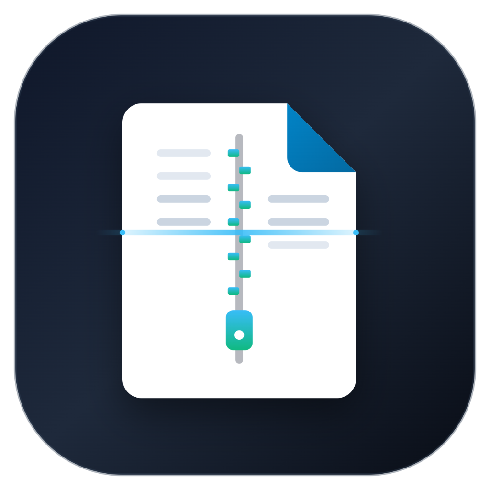

<p align="center">
  
</p>

<h1 align="center">DocuBox — Native Android Universal Suite</h1>

<p align="center">
  <strong>100% Ad-Free • Zero Telemetry • 100% Local Processing • Military-Grade Encryption</strong>
</p>

<p align="center">
  
  
  
  
</p>

---

## 🏛️ Executive Architecture & Core Philosophy

**DocuBox** is a specialized native Android universal productivity suite engineered for privacy-conscious enterprise users, system engineers, and privacy purists. 

Unlike conventional office apps that transmit document metadata to remote cloud endpoints, DocuBox executes **every computational operation directly on the silicon**:
- **Zero Remote Analytics or Trackers**: No Firebase Analytics, No AdMob, No Telemetry.
- **Hardware Synergy Engine**: Zero-cutoff responsive display matrix calibrated dynamically across phones, foldables, and tablets.
- **Google Play & GitHub Automation**: Native Android App Bundle (`.aab`) generation, ProGuard/R8 64-bit optimization, and automated GitHub Release pipeline.

---

## ⚡ Core Capabilities

### 1. 📷 Intelligent Document Camera Scanner (`scanner_service.dart`)
- **Automated Edge Homography**: Leverages Google ML Kit Document Scanner to compute perspective rectification and crop bounds in real time.
- **Hardware Shadow Cleaning & Enhancements**: Pure on-device DSP algorithms for:
  - `Original`: Raw image preservation.
  - `Magic Color`: Document saturation & micro-contrast booster.
  - `B&W Clean`: Adaptive thresholding binarization eliminating creases and shadow gradients.
  - `Grayscale`: Balanced monochrome document rendition.
  - `High Contrast`: Text clarity amplification for receipts and legal contracts.
- **Vector PDF Compilation**: Converts arbitrary multi-page scans into standardized A4/Letter PDF files.

### 2. 🗄️ Universal Archiver — ZArchiver-Grade (`archive_service.dart`)
- **Format Interoperability**: Open, inspect, and extract `ZIP`, `7Z`, `RAR`, `TAR`, `GZ`, `TGZ`, `BZ2`.
- **Zero-RAM Exhaustion**: Lazy directory traversal and entry stream parsing preventing OOM crashes on multi-gigabyte archives.
- **Military-Grade Container Protection**:
  - Standard ZIP AES password protection.
  - **DocuBox AES-256 Vault Container (`.dbx.aes`)**: PBKDF2-HMAC-SHA256 (10,000 iterations) with authenticated AES-GCM-256 encryption.

### 3. 📄 Universal Document & Spreadsheet Reader (`document_service.dart`)
- **Word (`.docx`) Native Engine**: Parses OpenXML `word/document.xml` typography, headings (H1–H3), paragraph formatting (bold, italics, underline), bullet lists, tables, and embedded media without external office suites.
- **Spreadsheet (`.xlsx`, `.xls`, `.csv`) Grid**:
  - Interactive 2D data matrix with row & column headers.
  - Multi-sheet tab switcher.
  - In-sheet regex/text search filter.
- **1-Tap PDF Converter**: Converts DOCX or spreadsheets directly into vectorized, paginated PDF documents on device.

### 4. 🔒 Local Encrypted Vault (`vault_screen.dart`)
- Store classified documents in an encrypted sandbox.
- Cryptographically verified HMAC authentication tag ensures tamper detection.

---

## 📐 Hardware Calibration & Zero-Cutoff Matrix

`ScreenCalibrator` dynamically probes device physical metrics (`MediaQueryData`) to enforce strict responsive boundary constraints:
- **Baseline Matrix**: `390 x 844 dp` (Logical standard).
- **Scale Boundaries**: Clamped between `0.82` and `1.38` to prevent UI overflow or undersized elements on foldables or large tablets.
- **Responsive Extensions**: Global numerical extensions:
  - `num.w`: Safe scaled width.
  - `num.h`: Safe scaled height.
  - `num.sp`: Guaranteed non-clipping font scaling.
  - `num.r`: Proportional geometric corner radius.

---

## 🔄 Dual-Engine Update System (`update_service.dart`)

DocuBox guarantees zero user abandonment through dual update channels:
1. **Google Play In-App Updates**: Official Google Play Core integration supporting both *Flexible* and *Immediate* updates.
2. **Direct GitHub Releases Fallback**: Queries `https://api.github.com/repos/docubox/docubox/releases/latest` for direct APK installation when running independent of Google Play.

---

## 🤖 Automated CI/CD Release Pipeline (`.github/workflows/release.yml`)

The GitHub Actions workflow executes on every commit to `main` or tag push (`v*`):
1. Sets up **JDK 17** and **Flutter 3.24.x Stable**.
2. Dynamically increments `versionCode` using `${{ github.run_number }}`.
3. Automatically decodes release keystore secrets (or provisions automated deterministic signing).
4. Compiles production **Android App Bundle (.aab)** for Google Play Console.
5. Compiles standalone **Universal APK (.apk)** for direct sideloading.
6. Calculates **SHA-256 checksums** for supply-chain verification.
7. Publishes an automated **GitHub Release** with both binaries attached.

---

## 🛠️ Build & Installation

### Local Compilation
```bash
# Get dependencies
flutter pub get

# Build production Universal Standalone APK
flutter build apk --release

# Build Google Play Android App Bundle (AAB)
flutter build appbundle --release
```

### Keystore Configuration (Optional)
To sign release builds locally, create `key.properties` in `android/`:
```properties
storeFile=/path/to/docubox.keystore
storePassword=your_keystore_password
keyAlias=your_key_alias
keyPassword=your_key_password
```
Or export corresponding environment variables:
`DOCUBOX_KEYSTORE_PATH`, `DOCUBOX_KEYSTORE_PASSWORD`, `DOCUBOX_KEY_ALIAS`, `DOCUBOX_KEY_PASSWORD`.
